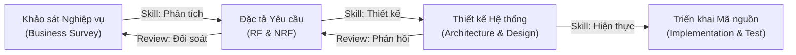

# SKILL: AI AGENT TRONG QUY TRÌNH PHÁT TRIỂN PHẦN MỀM (SDLC)

## 1. Giới thiệu & Mục tiêu
Skill này quy định vai trò, trách nhiệm và chu trình tương tác của **AI Agent** trong vòng đời phát triển phần mềm (**SDLC - Software Development Life Cycle**) của dự án **Hệ Thống Quản Trị Tuyển Dụng Doanh Nghiệp (ATS-HTQLTD)**.

---

## 2. Các Giai đoạn SDLC có AI Agent tham gia

### Giai đoạn 1: Từ Khảo sát (Survey) ➔ Đặc tả Yêu cầu (RF, NRF)
* **Đầu vào (Input):** Tài liệu khảo sát nghiệp vụ tuyển dụng thực tế (video phần mềm 365, quy trình tuyển dụng B2B của các doanh nghiệp).
* **AI Agent Action (Skill):**
  - Đọc hiểu nghiệp vụ, chuẩn hóa và phân loại thành:
    - **Yêu cầu chức năng (RF - Functional Requirements):** Quản lý đợt tuyển (`JobPosting`), Cổng nộp đơn độc lập (`/apply/[jobId]`, `/careers/[slug]`), Bóc tách CV PDF & Chấm điểm độ khớp AI (`Candidate`), Quản lý lịch phỏng vấn kết nối Google Meet (`Interview`), Pipeline Kanban theo giai đoạn (`ProcessStage`).
    - **Yêu cầu phi chức năng (NRF - Non-Functional Requirements):** Bảo mật dữ liệu nhiều công ty (Multi-tenant cách ly bằng `companyId`), Vercel Serverless (xử lý tệp PDF trực tiếp trên RAM Buffer không ghi disk), Giao diện Clean UI theo chuẩn `AGENTS.md` (Theme kem `#F2F1ED`, Font `Be Vietnam Pro`, tốc độ phản hồi < 2s).
* **Vòng lặp Đánh giá (Review):**
  - Con người (HR, PO, Thầy/Cô) kiểm tra lại danh sách RF/NRF. Nếu chưa sát thực tế, AI Agent cập nhật lại khảo sát và tinh chỉnh danh mục yêu cầu.

---

### Giai đoạn 2: Từ RF, NRF ➔ Thiết kế Hệ thống (System Design)
* **Đầu vào (Input):** Danh sách RF và NRF đã được phê duyệt trong `DOCS.md`.
* **AI Agent Action (Skill):**
  - **Thiết kế Cơ sở dữ liệu (Database Schema):** Sinh mã `prisma/schema.prisma` với 9 thực thể chuẩn hóa: `Company`, `Department`, `User`, `RecruitmentProcess`, `ProcessStage`, `JobPosting`, `Candidate`, `Interview`, `Notification`.
  - **Thiết kế Kiến trúc (Architecture):** Next.js App Router (Client Components + Server Components), API Route Handlers, Database Serverless Neon PostgreSQL, Middleware kiểm tra phiên đăng nhập bằng JWT Cookie.
  - **Thiết kế API Specs:** `/api/jobs`, `/api/candidates`, `/api/interviews`, `/api/external/apply`, `/api/chatbot`.
* **Vòng lặp Đánh giá (Review):**
  - Rà soát ràng buộc toàn vẹn dữ liệu (Cascade delete, Foreign Keys), kiểm tra cơ chế phân quyền RBAC (`COMPANY_ADMIN`, `HR`, `INTERVIEWER`).

---

### Giai đoạn 3: Hiện thực hóa & Kiểm thử (Implementation & Test)
* **AI Agent Action (Skill):**
  - Tự động sinh mã nguồn, tích hợp các thư viện chuẩn `@google/genai`, `@prisma/client`, `lucide-react`.
  - Chạy `npm run build` để kiểm tra tĩnh toàn bộ lỗi cú pháp, kiểu dữ liệu TypeScript và xung đột Route trước khi bàn giao.
